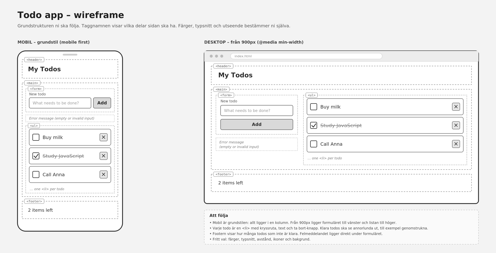

# Todo-app

**Miniprojekt 1 · FSTK26M · Onsdag 14/10**

Ni ska bygga en todo-app i team. Man ska kunna lägga till uppgifter, markera dem som klara, ta bort dem, och allt ska finnas kvar när sidan laddas om.

## Wireframe



Strukturen följer ni. Färger, typsnitt och utseende bestämmer ni själva.

## Så arbetar ni

- Teamet har **ett repo** på GitHub. Den som skapar det bjuder in de andra under *Settings, Collaborators*.
- **En person skriver kod åt gången.** De andra sitter med, diskuterar och resonerar tillsammans om hur ni ska lösa det.
- **Byt person efter varje steg** i listan. Den som skrivit gör `git add .`, `git commit` och `git push`. Nästa person kör `git clone` första gången, och därefter `git pull` innan hen börjar skriva.
- Pusha alltid innan ni byter, och `pull` alltid innan ni börjar. Commit-meddelanden ska vara tydliga och på engelska.
- **Alla i teamet ska kunna förklara all kod.**
- All kod ska vara på engelska: variabler, funktioner, id:n och klasser.
- Skriv korta anteckningar om era tekniska val medan ni bygger.

## Vad projektet ska innehålla

**Funktioner**

- [ ] **Lägga till** en todo med formuläret. Det ska fungera både med knappen och med Enter.
- [ ] **Validering:** ett tomt fält, eller ett fält med bara mellanslag, ger ett felmeddelande under formuläret och lägger inte till något.
- [ ] **Rendera från en array:** alla todos ligger i en array av objekt, och sidan ritas ut från den med en `render()`-funktion.
- [ ] **Markera som klar:** ett klick på en todo växlar mellan klar och inte klar. Klara todos ska se annorlunda ut, till exempel genomstrukna.
- [ ] **Ta bort:** en ×-knapp på varje todo tar bort den, både ur arrayen och från sidan.
- [ ] **Räknare:** footern visar hur många todos som inte är klara, till exempel `2 items left`.
- [ ] **Spara med localStorage:** en `save()`-funktion sparar arrayen, så att allt, också vilka som är klara, finns kvar efter att sidan laddats om. Trasig sparad data ska inte få sidan att krascha.

Varje todo är ett objekt, till exempel:

```js
{ text: "Buy milk", done: false }
```

**Struktur och kod**

- [ ] Mobil först, och från 900px ligger formuläret till vänster och listan till höger, som i wireframen.
- [ ] Semantiska taggar: `<header>`, `<main>`, `<form>`, `<ul>` och `<footer>`. Formulärfältet har en `<label>`.
- [ ] Tre filer: `index.html`, `style.css` och `script.js`.

**Klart när**

- [ ] Koden ligger på GitHub och appen fungerar.

## Så här kan ni gå tillväga

Gör en commit efter varje steg.

1. **Projektet.** Skapa en mapp med de tre filerna, ett tomt repo på GitHub och gör första push.
2. **HTML.** Bygg sidan från wireframen, med några todos som exempel direkt i HTML:en. *Klart när:* alla delar finns i rätt ordning.
3. **CSS.** Styla mobilvyn först, och lägg sedan till två kolumner från 900px. *Klart när:* det ser ut som wireframen i båda storlekarna.
4. **Data och element.** Hämta elementen i `script.js` och skapa en tom array för todos.
5. **Lägga till.** Lyssna på formuläret, validera, och lägg ett objekt i arrayen. *Klart när:* `console.log` visar arrayen efter varje tillägg.
6. **Rita ut.** Skriv `render()` som ritar listan från arrayen. Ta bort exemplen ur HTML:en, och anropa `render()` efter varje ändring. *Klart när:* nya todos dyker upp på sidan.
7. **Markera som klar.** Ett klick ändrar `done` i arrayen, och sidan ritas om. *Klart när:* klara todos ser annorlunda ut.
8. **Ta bort.** ×-knappen tar bort rätt todo ur arrayen, och sidan ritas om. *Klart när:* rätt rad försvinner, också mitt i listan.
9. **Räknaren.** Uppdatera räknaren i footern när listan ritas ut.
10. **Spara.** Skriv `save()` som sparar arrayen, och anropa den efter varje ändring. Läs in arrayen när sidan startar. *Klart när:* allt finns kvar efter att sidan laddats om.
11. **Slutputs.** Styling, kontrollera att allt fungerar, och sista push.


## Presentation
 
Sist under dagen visar varje team sin app för gruppen, cirka fem minuter per team.
 
- Visa hur appen ser ut och fungerar, både som mobil och som dator.
- Berätta hur ni tänkt: hur ni delade upp arbetet, vad som var klurigast, och något ni valde själva.
- Fördela så att alla i teamet säger något.

  
## Bonus

- En knapp **Clear completed** som tar bort alla klara todos.
- Dubbelklicka på en todo för att ändra texten.
- Olika färg på klara och ej klara todos med `classList`.
